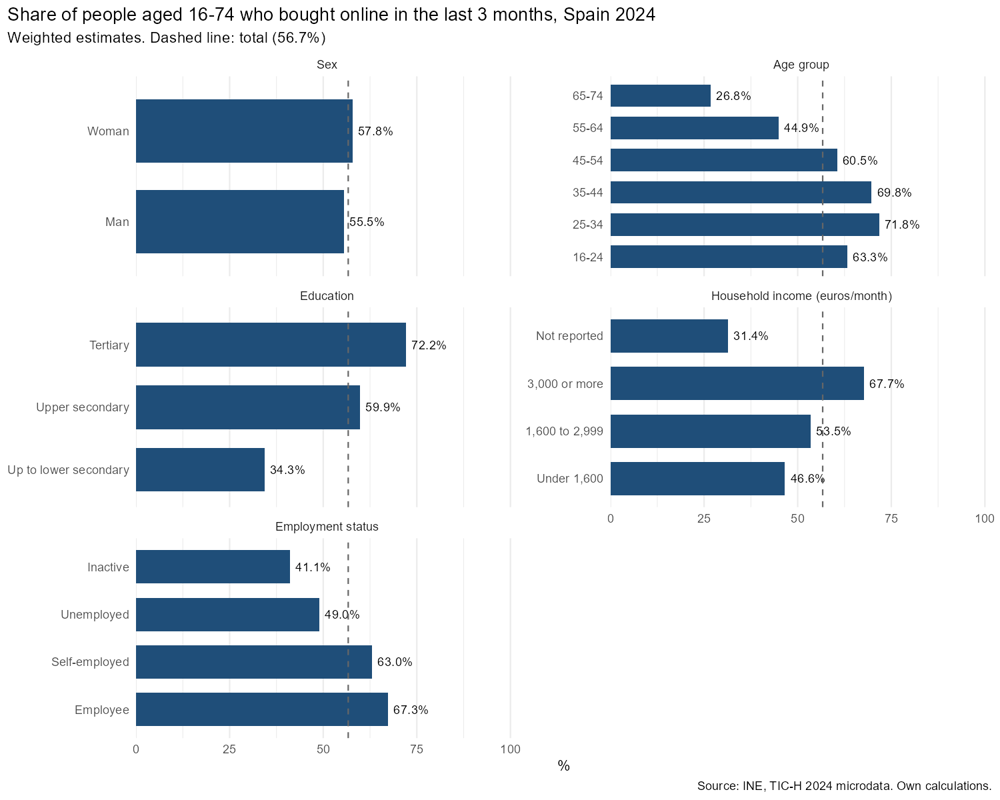
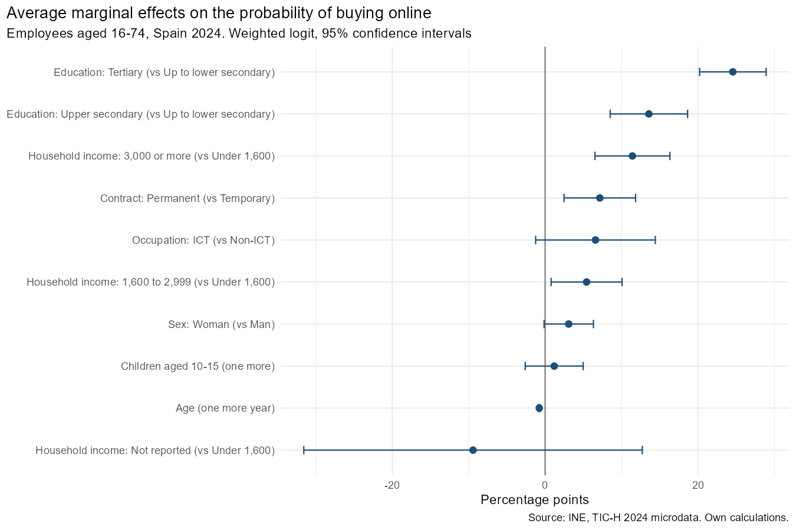

# Who buys online in Spain? Evidence from the INE ICT household survey, 2024

R code to measure online shopping in Spain and model its determinants with the microdata of the **Survey on Equipment and Use of Information and Communication Technologies in Households (TIC-H) 2024** of the Spanish National Statistics Institute (INE). The outcome is binary (bought online or not), so the determinants are estimated with a **binary choice model (logit)**. The pipeline cleans the microdata, estimates weighted shares by population group, fits a weighted logit model for employees and reports average marginal effects and predictive performance.

## Main results

- **56.7%** of people aged 16 to 74 bought something online in the last 3 months.
- The share falls sharply with age (71.8% at 25-34, 26.8% at 65-74) and rises with education (34.3% up to lower secondary, 72.2% with tertiary education).
- Among employees (6,638 observations), holding the other factors constant:
  - tertiary education raises the probability of buying online by **24.6 percentage points** compared with lower secondary or less;
  - a household income of 3,000 euros or more per month raises it by **11.4 points** compared with less than 1,600 euros;
  - a permanent contract raises it by **7.2 points** compared with a temporary one;
  - each additional year of age lowers it by **0.8 points**.
- The model has an area under the ROC curve of **0.71**. It classifies buyers well (sensitivity 88%) but non-buyers poorly (specificity 37%), and its accuracy (71.3%) is only slightly above the share of the majority class (67.1%).





## Data

INE, *Encuesta sobre Equipamiento y Uso de Tecnologías de Información y Comunicación en los Hogares* (TIC-H), 2024, household questionnaire file. The microdata are public and can be downloaded from the [INE microdata portal](https://www.ine.es/prodyser/microdatos.htm). They are not included in this repository.

Download the 2024 file in R format and save `TICHCuestionario_2024.RData` (objects `Microdatos` and `Metadatos`) in the `data/` folder.

## Method

- **Outcome:** bought online in the last 3 months (`ULT_COM = 1`), the INE headline indicator. People who did not use the internet in the last year are counted as non-buyers.
- **Population:** people aged 16 to 74. The model is estimated for employees, because contract type and ICT occupation are only asked to them.
- **Covariates:** age, sex, education level (CNED-2014), contract type, ICT occupation, net monthly household income and number of children aged 10 to 15.
- **Model:** binary choice model. The outcome $y_i$ takes the value 1 if person $i$ bought online in the last 3 months and 0 otherwise, and its probability is modelled with the logistic function:

  $$P(y_i = 1 \mid x_i) = \Lambda(x_i'\beta) = \frac{\exp(x_i'\beta)}{1 + \exp(x_i'\beta)}$$

  The coefficients $\beta$ are changes in the log-odds of buying online. They are reported as odds ratios in `output/tables/logit_coefficients.csv` and, to read them as changes in probability, as average marginal effects.
- **Estimation:** maximum likelihood with the person weight (`FACTOR_P`), using `svyglm()` from the `survey` package. The public file has no cluster or strata identifiers, so standard errors only account for the weights.
- **Average marginal effects:** the average change in the predicted probability, in percentage points, when a continuous variable increases by one unit or when a category replaces the reference category. Standard errors by the delta method (see `R/utils.R`).
- **Fit:** weighted pseudo R², accuracy against the no-information rate, sensitivity, specificity and ROC curve.

## How to run

```r
install.packages(c("here", "dplyr", "ggplot2", "survey", "scales", "tidyr"))
source("R/00_run_all.R")
```

The tables are saved in `output/tables/` and the figures in `output/figures/`.

## Repository structure

```
online-shopping-spain-ine/
├── R/
│   ├── 00_run_all.R         # runs the whole pipeline
│   ├── 01_prepare_data.R    # cleans the microdata and builds the variables
│   ├── 02_descriptive.R     # weighted shares by group and figure
│   ├── 03_model.R           # weighted logit, marginal effects, fit and ROC curve
│   └── utils.R              # marginal effects, AUC and ROC helpers
├── data/                    # INE microdata (not tracked)
└── output/
    ├── figures/
    └── tables/
```

## Author

Dax Mancilla, economist (M.Sc. Applied Economics, Universidad Complutense de Madrid). [LinkedIn](https://linkedin.com/in/dax-mancilla-575b0814a)
